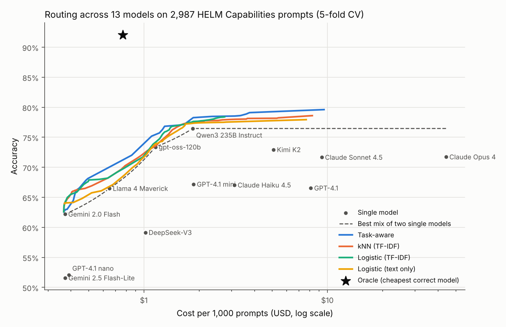
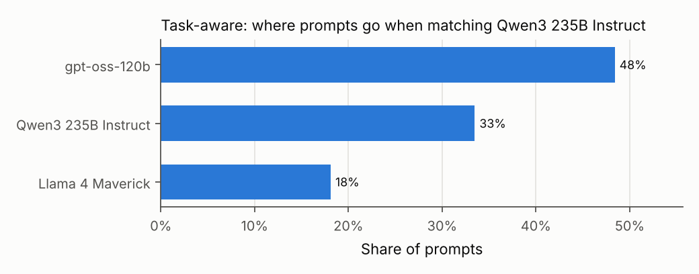
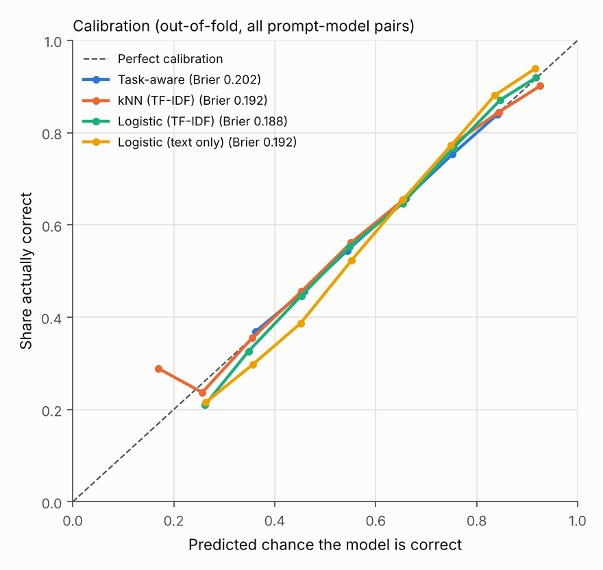

# routewise

[](https://github.com/saidurpulok/routewise/actions/workflows/ci.yml)

**How much can a simple learned router save by sending each prompt to the
cheapest model likely to get it right?** routewise measures that offline on real
per-question results from Stanford's HELM leaderboards. HELM has already asked
every model the same questions and scored each answer, so all routewise needs to
add is prices and routing.

The short version: the saving depends heavily on how good the cheap models
already are.

- **On 2025 models** (Claude 4.5, GPT-4.1, Llama 4, Qwen3, Kimi K2, gpt-oss)
  and hard tasks, the best single model is the open-weight Qwen3 235B, at 76.5%
  for $1.85 per 1,000 prompts. A router matches it for about 25–30% less, and
  reaches 79.6% when cost doesn't matter.
- **On 2024 models** and easier tasks, cheap models have big blind spots on
  some tasks. There a router matches GPT-4o for 94% less, and costs about half as
  much as DeepSeek-V3, the best cheap model, at the same accuracy.



## Why I built it

Routing between LLMs is a common way to cut serving costs, but published
savings often depend on an unstated baseline. I wanted a small, honest version I
could rerun: real prompts, real per-model outcomes, cross-validation, confidence
intervals, and the single-model baselines that make savings look smaller.

## Setup

**Data.** Two HELM leaderboards publish every question, each model's answer,
the token counts and whether the answer was scored correct. `routewise fetch`
downloads them from HELM's public bucket and keeps the prompts every model in
the pool answered.

| Suite | Tasks | Prompts | Models |
| --- | --- | ---: | ---: |
| [HELM Capabilities](https://crfm.stanford.edu/helm/capabilities/) | MMLU-Pro (1,000), GPQA (446), IFEval (541), Omni-MATH (1,000) | 2,987 | 13, released 2025 |
| [HELM Lite](https://crfm.stanford.edu/helm/lite/) | GSM8K, MATH, MMLU, MedQA, LegalBench, OpenBookQA | 5,551 | 10, released 2024 |

**Prices.** Public list prices per 1M tokens, in `configs/<suite>/models.yaml`.
OpenAI, Anthropic and Google use their own prices. Open-weight models use
Together AI's prices, since HELM ran them through Together.

**Two data problems, and what I did about them:**

- **Missing output tokens.** HELM records zero output tokens for every Gemini
  and DeepSeek-V3 answer, which would make those models look almost free. For
  those models, routewise uses the median output length of the other models on
  the same prompt. `results.json` lists every model this applies to.
- **Hidden reasoning tokens.** Reasoning models such as GPT-5, o3, Grok 4 and
  Gemini 3 Pro are billed for thinking tokens that HELM doesn't record. Their
  costs can't be recovered, so they aren't in the pool. gpt-oss-120b is included
  because its recorded output appears to include its reasoning (on IFEval it's
  two to three times longer than other models'), but that's an inference.

**Routing.** Each router estimates, for every prompt and model, the probability
the model answers correctly. All routers then share one rule: choose the model
that maximizes `p_correct - λ · expected_cost`, and sweep `λ` to trace a
cost-accuracy curve. Expected cost uses only what is known before sending a
request: the prompt's real token count and the model's average output length on
training prompts of the same task (or on all training prompts, for the router
that doesn't see the task).

| Router | What it uses |
| --- | --- |
| Task-aware | each model's training accuracy on the prompt's task |
| kNN (TF-IDF) | the 25 most similar training prompts, smoothed toward the task average |
| Logistic (TF-IDF) | one logistic regression per model on TF-IDF features and the task label |
| Logistic (text only) | the same, but with no task label anywhere, including the cost estimate |

**Evaluation.** 5-fold cross-validation, stratified by task, so every routing
decision is made by a router that never saw that prompt. Savings come with a 95%
bootstrap interval over prompts. Two reference points frame the curves: the best
random mix of two single models (dashed in the plots), and an oracle that always
picks the cheapest correct model.

## Results: 2025 models (HELM Capabilities)

| Model | Accuracy | $ per 1k prompts |
| --- | ---: | ---: |
| Gemini 2.0 Flash | 62.2% | 0.372 |
| Gemini 2.5 Flash-Lite | 51.6% | 0.373 |
| GPT-4.1 nano | 52.1% | 0.391 |
| Llama 4 Maverick | 66.5% | 0.650 |
| DeepSeek-V3 | 59.2% | 1.019 |
| gpt-oss-120b | 73.4% | 1.157 |
| Qwen3 235B Instruct | **76.5%** | 1.849 |
| GPT-4.1 mini | 67.2% | 1.866 |
| Claude Haiku 4.5 | 67.1% | 3.112 |
| Kimi K2 | 72.9% | 5.093 |
| GPT-4.1 | 66.6% | 8.126 |
| Claude Sonnet 4.5 | 71.7% | 9.311 |
| Claude Opus 4 | 71.7% | 44.314 |

| Router | Best accuracy | $ per 1k to match Qwen3 | Saving vs Qwen3 (95% CI) |
| --- | ---: | ---: | ---: |
| Task-aware | **79.6%** | **1.30** | 29.8% (−0.3 to 40.6%) |
| kNN (TF-IDF) | 78.6% | 1.48 | 19.7% (−1.0 to 26.7%) |
| Logistic (TF-IDF) | 78.4% | 1.39 | 24.9% (5.4 to 32.6%) |
| Logistic (text only) | 77.9% | 1.59 | 14.0% (4.2 to 19.8%) |
| Oracle (upper bound) | 92.1% | 0.77 | |

- **Open-weight models lead this mix.** Qwen3 235B and gpt-oss-120b are the two
  most accurate models here, at a fraction of the closed models' prices. Matching Claude Sonnet
  4.5's 71.7% costs $0.86 per 1k prompts instead of $9.31. That's mostly because
  cheap open models already beat Sonnet 4.5 on these four tasks, not because
  routing is clever.
- **Against the strongest model, the saving is modest.** Matching Qwen3 costs
  25–30% less with routing, and only the logistic router's interval clears
  zero.
- **Routing still beats every single model.** The task-aware router reaches
  79.6%, 3.1 points above Qwen3, by sending each task to the model that is best
  at it. It's up to 4.0 points above the best mix of two single models at the
  same cost.
- **Reading the prompt doesn't help here, but knowing the task does.** The
  text-based routers do no better than the task-aware one. Without the task
  label, the saving drops to 14%. Word overlap says little about which model
  will solve a graduate-level science question.
- **The headroom is large.** The oracle reaches 92.1% for $0.77, so a better
  quality predictor has a lot to gain.

When matching Qwen3, the task-aware router sends 48% of prompts to gpt-oss-120b,
33% to Qwen3 and 18% to Llama 4 Maverick:



## Results: 2024 models (HELM Lite)

| Model | Accuracy | $ per 1k prompts |
| --- | ---: | ---: |
| Gemini 1.5 Flash | 62.9% | 0.106 |
| GPT-4o mini | 71.5% | 0.208 |
| Llama 3.1 8B | 45.1% | 0.218 |
| DeepSeek-V3 | 79.1% | 0.361 |
| Qwen2.5 7B | 69.4% | 0.382 |
| Llama 3.1 70B | 75.4% | 1.060 |
| Claude 3.5 Haiku | 67.5% | 1.155 |
| Gemini 1.5 Pro | 78.3% | 1.759 |
| GPT-4o | **79.2%** | 3.354 |
| Claude 3.5 Sonnet | 77.0% | 4.148 |

| Router | Best accuracy | $ per 1k to match GPT-4o | Saving vs GPT-4o (95% CI) |
| --- | ---: | ---: | ---: |
| Task-aware | 82.5% | 0.244 | 92.7% (92.2–93.9%) |
| kNN (TF-IDF) | 82.9% | 0.187 | 94.4% (93.3–94.9%) |
| Logistic (TF-IDF) | **83.6%** | **0.188** | **94.4% (93.9–95.1%)** |
| Logistic (text only) | 83.4% | 0.187 | 94.4% (93.8–95.0%) |
| Oracle (upper bound) | 94.5% | 0.184 | |

- **The headline saving is mostly DeepSeek-V3.** It matches GPT-4o's accuracy to
  within 0.1 points on its own, for 89% less. Against DeepSeek-V3, the logistic
  router is 48% cheaper at the same accuracy, or 3.1 points more accurate at the
  same cost.
- **Routing beats every single model.** With no cost penalty the logistic router
  reaches 83.6%, 4.5 points above GPT-4o, for $2.25 per 1k prompts. It's up to
  10.5 points above the best mix of two single models at the same cost.
- **Here the prompt text helps.** Reading the prompt makes matching GPT-4o 23%
  cheaper than the task label alone, and the text-only router does just as well
  as the ones given the label, so the label isn't needed on these tasks.

The full plots are in [results/lite/plots](results/lite/plots).

## What the two suites say together

A router saves the most when cheap models are strong on some tasks and weak on
others. That was true of 2024 models, where Gemini 1.5 Flash scored 93% on MATH
but 33% on GSM8K (partly because of HELM's answer format). Among 2025 models, cheap open-weight models are strong across
the board, so the cheapest good choice is often obvious and a router's job is
smaller. A claim like "routing saves 90%" only means something next to the best
single model it's compared with.

## Are the predicted probabilities trustworthy?

The selection rule trusts each router's probability that a model gets a prompt
right, so I checked them on the out-of-fold predictions. All four routers are
well calibrated: when a router says 70%, the model is right about 70% of the
time. The expected calibration error is below 0.03 everywhere.

Better probabilities don't automatically mean better routing, though. On the 2025
suite the TF-IDF logistic router has the best Brier score (0.188, against 0.202
for the task-aware router), but it doesn't route better.



## Related work

routewise doesn't propose a new routing method. It's a small, reproducible
evaluation of simple ones on public data.

- [FrugalGPT](https://arxiv.org/abs/2305.05176) (Chen, Zaharia and Zou, 2023)
  cuts cost with an LLM cascade: try cheap models first and stop when a scorer
  is confident.
- [RouterBench](https://arxiv.org/abs/2403.12031) (Hu et al., 2024) is a
  benchmark of precomputed outputs for evaluating routers, with the same kind of
  cost-quality curves and oracle used here.
- [RouteLLM](https://arxiv.org/abs/2406.18665) (Ong et al., ICLR 2025) trains
  routers between a strong and a weak model from human preference data.

The difference here is the data: HELM's per-question results for current
models, with real token counts, plus the corrections those counts need.

## Caveats

- **List prices, not your bill.** Prices change, and batch discounts, caching and
  provider choice all move them. Edit `configs/<suite>/models.yaml` and rerun to
  see how the routing shifts.
- **Imputed output lengths** for Gemini and DeepSeek-V3 make their costs
  estimates, not measurements.
- **HELM's prompts and scoring, not production traffic.** Each model saw one
  fixed prompt format, and some scores reflect answer formatting more than
  ability. IFEval counts a prompt as correct only when every instruction in it
  was followed.
- **Most routers use the task label.** Real traffic rarely comes labeled. The
  text-only router shows what that's worth: nothing on the 2024 tasks, about
  half the saving on the 2025 ones.
- **One run per model, binary correctness.** HELM ran each prompt once, so
  sampling noise in the outcomes isn't modeled.
- **The matched point is picked on the evaluation curve**, so it's slightly
  optimistic. The bootstrap interval covers prompt sampling, not that choice.

## Run it

You need Python 3.11+ and [uv](https://docs.astral.sh/uv/).

```bash
uv sync --locked --group dev
uv run routewise fetch   # about 260 MB of HELM files for the 2025 suite
uv run routewise run     # cross-validates the four routers, a few minutes on a laptop
uv run routewise plot    # redraws the plots from results.json

uv run routewise --suite lite fetch   # the same for the 2024 suite (about 30 MB)
```

Checks:

```bash
uv run ruff check . && uv run ruff format --check . && uv run mypy src
uv run pytest
```

The tests use small synthetic data, so they need no download.

## Repository layout

- `src/routewise/data.py`: finds and downloads HELM runs, builds the routing table
- `src/routewise/routers.py`: the routers and the shared selection rule
- `src/routewise/evaluate.py`: cross-validation, curves, baselines, bootstrap,
  calibration
- `src/routewise/plot.py`, `src/routewise/cli.py`: figures and the command line
- `configs/<suite>/`: models, prices and tasks
- `results/<suite>/`: results and plots

## What I'd try next

- Reasoning models, using a source that records thinking tokens.
- A stronger label-free router, using sentence embeddings or a small
  fine-tuned encoder in place of TF-IDF.
- A cascade that tries a cheap model first and escalates on low confidence.

## License

MIT. HELM data belongs to Stanford CRFM and isn't redistributed here;
`routewise fetch` downloads it from their public bucket.
