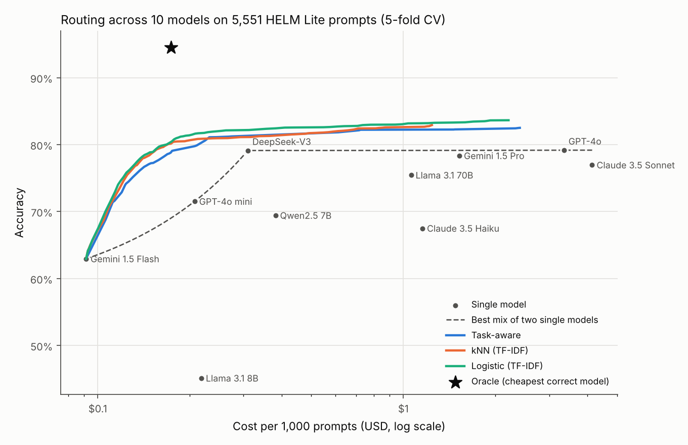
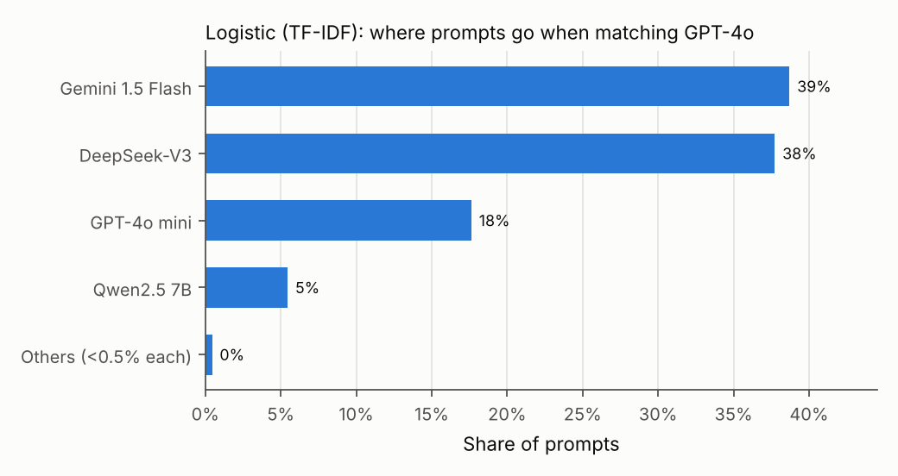

# routewise

[](https://github.com/saidurpulok/routewise/actions/workflows/ci.yml)

**How much can a simple learned router save by sending each prompt to the
cheapest model likely to get it right?** routewise measures that offline on real
per-question results: 5,551 prompts from six HELM Lite tasks, each already
answered and scored for ten models, priced at public list prices.

The short version: a logistic-regression router on TF-IDF features matched
GPT-4o's accuracy (79.2%) for $0.155 per 1,000 prompts instead of $3.35, a 95%
saving. Most of that saving comes from one cheap, strong model, though:
DeepSeek-V3 alone scores 79.1% for $0.31. The fairer comparison is against
DeepSeek-V3, where the router is 50% cheaper at the same accuracy. With no cost
penalty it reaches 83.6%, higher than any single model.



## Why I built it

Routing between LLMs is a common way to cut serving costs, but published
savings often depend on an unstated baseline. I wanted a small, honest version I
could rerun: real prompts, real per-model outcomes, cross-validation, confidence
intervals, and the single-model baselines that make savings look smaller.

## Setup

**Data.** [HELM Lite](https://crfm.stanford.edu/helm/lite/) publishes every
question it asked each model, the token counts, and whether the answer was
scored correct. `routewise fetch` downloads those files from HELM's public
bucket and keeps the prompts that all ten models answered:

| Task | Prompts | Notes |
| --- | ---: | --- |
| GSM8K | 1,000 | grade-school math, exact final number |
| LegalBench | 2,047 | five subsets |
| MATH | 437 | seven subjects, level 1, chain of thought |
| MedQA | 1,000 | medical licensing questions |
| MMLU | 567 | five subjects |
| OpenBookQA | 500 | science multiple choice |

**Models and prices.** Ten models with HELM Lite results, priced at public list
prices per 1M tokens ([configs/models.yaml](configs/models.yaml)): Gemini 1.5
Flash and Pro, GPT-4o mini and GPT-4o, Claude 3.5 Haiku and Sonnet, DeepSeek-V3,
Llama 3.1 8B and 70B, and Qwen2.5 7B.

**Routing.** Each router estimates, for every prompt and model, the probability
the model answers correctly. All routers then share one rule: choose the model
that maximizes `p_correct - λ · expected_cost`, and sweep `λ` to trace a
cost-accuracy curve. Expected cost uses only what is known before sending a
request: the prompt's real token count and the task's average output length on
training prompts.

| Router | What it uses |
| --- | --- |
| Task-aware | each model's training accuracy on the prompt's task |
| kNN (TF-IDF) | the 25 most similar training prompts, smoothed toward the task average |
| Logistic (TF-IDF) | one logistic regression per model on TF-IDF features and the task label |

**Evaluation.** 5-fold cross-validation, stratified by task, so every routing
decision is made by a router that never saw that prompt. Savings come with a 95%
bootstrap interval over prompts. Two reference points frame the curves: the best
random mix of two single models (dashed in the plot), and an oracle that always
picks the cheapest correct model.

## Results

Single models, all 5,551 prompts:

| Model | Accuracy | $ per 1k prompts |
| --- | ---: | ---: |
| Gemini 1.5 Flash | 62.9% | 0.092 |
| GPT-4o mini | 71.5% | 0.208 |
| Llama 3.1 8B | 45.1% | 0.218 |
| DeepSeek-V3 | 79.1% | 0.310 |
| Qwen2.5 7B | 69.4% | 0.382 |
| Llama 3.1 70B | 75.4% | 1.060 |
| Claude 3.5 Haiku | 67.5% | 1.155 |
| Gemini 1.5 Pro | 78.3% | 1.525 |
| GPT-4o | **79.2%** | 3.354 |
| Claude 3.5 Sonnet | 77.0% | 4.148 |

Routers, cross-validated:

| Router | Best accuracy | $ per 1k to match GPT-4o | Saving vs GPT-4o (95% CI) | Accuracy at DeepSeek-V3's cost |
| --- | ---: | ---: | ---: | ---: |
| Task-aware | 82.5% | 0.208 | 93.8% (93.3–95.1%) | 81.2% |
| kNN (TF-IDF) | 82.9% | 0.156 | 95.4% (94.8–95.7%) | 81.1% |
| Logistic (TF-IDF) | **83.6%** | **0.155** | **95.4% (94.9–95.8%)** | **82.1%** |
| Oracle (upper bound) | 94.5% | 0.174 | | |

- **The headline saving is mostly DeepSeek-V3.** Against GPT-4o every router
  saves about 95%, but DeepSeek-V3 on its own already saves 91% at less than 0.1 points
  lower accuracy. Against DeepSeek-V3, the logistic router reaches the same
  accuracy for half the cost, or 3 points more accuracy for the same cost.
- **Routing beats every single model.** With the cost penalty off, the logistic
  router picks the most likely correct model per prompt and reaches 83.6%, 4.5
  points above GPT-4o, for $2.21 per 1k prompts.
- **It beats mixing models blindly.** At the same cost, the logistic router is
  up to 11.8 points more accurate than the best random mix of two single models.
- **Knowing the task gets you most of the way.** The task-aware router, which
  ignores the prompt text, already captures most of the gain. Reading the prompt
  adds about 1 point of accuracy and makes matching GPT-4o 25% cheaper.
- **There is a lot of headroom.** The oracle reaches 94.5% for $0.174, so a
  better quality predictor could gain far more than these simple ones do.

When matching GPT-4o, the logistic router sends 39% of prompts to Gemini 1.5
Flash, 38% to DeepSeek-V3, 18% to GPT-4o mini and 5% to Qwen2.5 7B, and almost
none to the expensive models:



All numbers come from [results/results.json](results/results.json), which also
holds per-task accuracy and the full curves.

## Caveats

- **List prices, not your bill.** Prices change, and batch discounts, caching and
  provider choice all move them. Edit `configs/models.yaml` and rerun to see how
  the routing shifts.
- **These are 2024-era models**, because HELM Lite has per-question results for
  them. The method carries over to current models; the numbers won't.
- **HELM's prompts and scoring, not production traffic.** Each model saw one
  fixed prompt format, mostly few-shot. Some scores reflect formatting more than
  ability: Gemini 1.5 Flash scores 32.8% on GSM8K but 92.9% on MATH, which
  probably comes from how HELM extracts its final answer. The router learns to
  avoid that, which is realistic, but it isn't a statement about the model.
- **Routers use the task label.** Real traffic rarely comes labeled. The kNN and
  logistic routers also read the prompt text, but they get the label too.
- **One run per model, binary correctness.** HELM ran each prompt once, so
  sampling noise in the outcomes isn't modeled, and partial credit is rounded
  to correct or incorrect at 0.5.
- **The matched point is picked on the evaluation curve.** The cost to match
  GPT-4o is read off the cross-validated curve, so choosing `λ` there is slightly
  optimistic. The bootstrap interval covers prompt sampling, not that choice.
- **LegalBench is 37% of the prompts**, so it weighs heavily on the averages.

## Run it

You need Python 3.11+ and [uv](https://docs.astral.sh/uv/).

```bash
uv sync --group dev
uv run routewise fetch   # downloads about 30 MB from HELM's public bucket
uv run routewise run     # cross-validates the three routers, a couple of minutes on a laptop
uv run routewise plot    # redraws results/plots from results/results.json
```

Checks:

```bash
uv run ruff check . && uv run ruff format --check . && uv run mypy src
uv run pytest
```

The tests use small synthetic data, so they need no download.

## Repository layout

- `src/routewise/data.py`: finds and downloads HELM Lite runs, builds the routing table
- `src/routewise/routers.py`: the three routers and the shared selection rule
- `src/routewise/evaluate.py`: cross-validation, curves, baselines, bootstrap
- `src/routewise/plot.py`, `src/routewise/cli.py`: figures and the command line
- `configs/`: models, prices and tasks

## What I'd try next

- Routers that don't need the task label, and a small fine-tuned encoder in
  place of TF-IDF.
- Current models and longer, more realistic prompts, including coding.
- Calibration checks on the predicted probabilities, since the selection rule
  relies on them.
- A cascade that tries a cheap model first and escalates on low confidence.

## License

MIT. HELM Lite data belongs to Stanford CRFM and isn't redistributed here;
`routewise fetch` downloads it from their public bucket.
